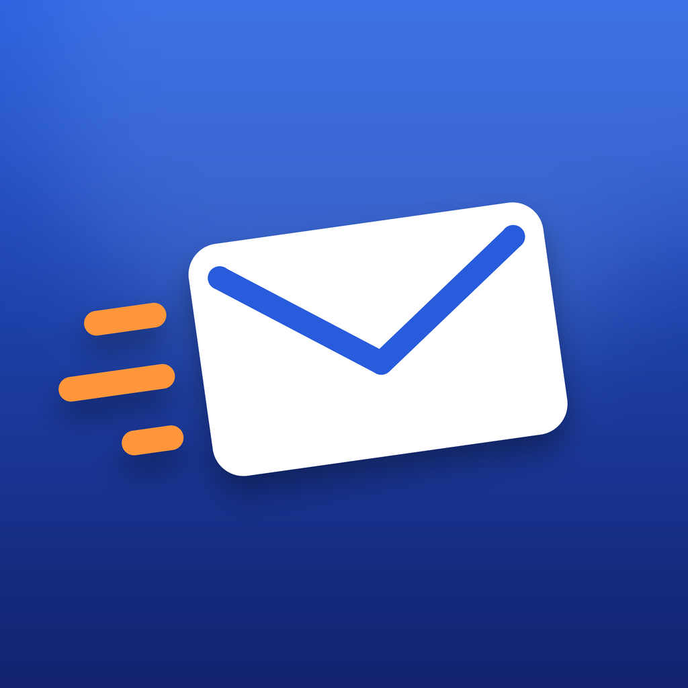

<p align="center">
  
</p>

<h1 align="center">dispatch</h1>

<p align="center">
  <em>A lean mail client for iPhone. IMAP in, SMTP out, nothing in between.</em>
</p>

<p align="center">
  <a href="https://github.com/SirOpolov/dispatch/releases/latest"></a>
  <a href="https://github.com/SirOpolov/dispatch/actions/workflows/build.yml"></a>
  
  
  <a href="https://pay.msero.de"></a>
</p>

---

A small, fast mail client for iOS 26 built with SwiftUI and Liquid Glass. No account, no cloud, no third-party libraries. Your mail goes straight from your provider to your phone.

- **One profile per address.** Switch accounts at the top of the sidebar.
- **Unified Inbox.** One shared profile that shows the emails of all accounts, with search across all of them.
- **Inbox your way.** Unread, read and all, plus favourites, verified, spam, trash and every other server folder.
- **Bulk actions.** Multi-select, mark all as read, delete all (favourites stay).
- **Folders.** Move single or selected emails to any server folder.
- **Auto-delete.** Per folder, emails older than a chosen number of days (counted from when the app fetched them) go to the trash. Favourites stay.
- **Write and reply.** Reply, reply all, forward, send and open attachments, copy saved to "Sent".
- **Always up to date.** Fetches while the app is open, in the background iOS checks and sends notifications.
- **Private by default.** Emails show as plain text, HTML and images only on request.
- **Sender rules.** Trusted senders land in "Verified" with HTML on, spam senders go to spam automatically. Press and hold an email to set them.
- **Sender icons.** Loaded from the sender's domain, letter placeholder otherwise, custom icons for trusted senders.
- **Own providers.** Save server presets (Strato and WEB.DE are included), add your own, remove any of them.
- **English and German.** Switch the language in settings.
- **Yours.** Light, dark or automatic, any accent colour. Passwords live in the keychain with AutoFill from password managers.

## Servers

| Provider | IMAP | SMTP |
|---|---|---|
| Strato | imap.strato.de:993 | smtp.strato.de:465 |
| WEB.DE | imap.web.de:993 | smtp.web.de:587 |

Ports 993 and 465 use SSL/TLS, all others STARTTLS. Any other provider works the same way: enter its servers or save them as a provider in settings.

## Install

Apple only runs signed apps. GitHub builds the app unsigned (`Dispatch.ipa`), you sign it with an Apple ID while installing.

### 1. Download

1. Open the [latest release](https://github.com/SirOpolov/dispatch/releases/latest) (GitHub login required).
2. Download `Dispatch.ipa`.

Messengers sometimes block `.ipa` files. Zip it before sending.

### 2. Sign and install

| | Free Apple ID | Paid developer account (99 €/year) |
|---|---|---|
| Lasts | 7 days | 1 year |
| iPhone must be connected to the computer | Yes | No, only the file goes back and forth |
| You need | iPhone and `.ipa` | `.ipa` and the iPhone's UDID |

**Sideloadly (Windows, macOS)**

1. Install [Sideloadly](https://sideloadly.io). On Windows also install iTunes and iCloud directly from Apple, not from the Microsoft Store.
2. Connect the iPhone by cable, unlock it, tap **Trust**.
3. Drag `Dispatch.ipa` into the window, enter your Apple ID, **Start**.
4. Enter password and verification code, wait for **Done**.

**Developer account:** Add the iPhone's UDID at [developer.apple.com/account](https://developer.apple.com/account) → **Devices**, sign the `.ipa` with a profile that contains this iPhone and install the signed file with Sideloadly. Sideloadly shows the UDID in the device info, or iTunes does when you click **Serial Number** a few times in the summary.

**iloader (Linux)**

```sh
sudo pacman -S usbmuxd && sudo systemctl start usbmuxd
```

Then start [iloader](https://github.com/nab138/iloader) as an AppImage, sign in with your Apple ID and choose `Dispatch.ipa` as a custom IPA. Not tested by me, use Sideloadly when in doubt.

### 3. Unlock once

1. **Settings → General → VPN & Device Management** → tap the developer app → **Trust**.
2. **Settings → Privacy & Security → Developer Mode** on. The switch only appears after installing. The iPhone restarts, then tap **Turn On**.

## Updates

> [!IMPORTANT]
> 1. **Never delete the app.** Accounts, rules and cached mail are gone with it.
> 2. **Always sign with the same Apple ID.** Another one installs a second app without your data.
> 3. **Install over the existing app.** Repeat steps 1 and 2, your data stays.

When the signature expires (7 days or 1 year) the app no longer opens, but your data is still there. Repeat step 2 with the same `.ipa` and the same Apple ID. A fixed weekly slot helps.

Coming from Laufbursche? Dispatch is a new app for iOS. Install it next to the old one, add your accounts again, then delete Laufbursche.

<details>
<summary>When something goes wrong</summary>

| Problem | Fix |
|---|---|
| Login fails with "NO authentication failed" | The provider rejects the login. Check the password, enable IMAP access at your provider and use an app password if two-factor authentication is on. |
| WEB.DE does not connect | In WEB.DE webmail go to **Settings → POP3/IMAP** and allow access via POP3 and IMAP. With two-factor authentication use an app password. |
| Error starts with "SMTP:" | Receiving works, sending does not. Check the SMTP server and port, some providers need port 587 instead of 465. |
| App opens briefly and closes | Signature expired → repeat step 2. Or Developer Mode is off → step 3. |
| "Untrusted Developer" | Step 3, trust the developer. |
| "Developer Mode" switch missing | Install the app first, then look again. |
| Sideloadly does not see the iPhone | Unlock, tap **Trust**, try another cable, on Windows install iTunes from Apple. |
| Error about too many apps | A free Apple ID may only have 3 self-signed apps at the same time. Delete one. |
| Error about too many App IDs | Free Apple IDs may only register a few new apps per week. Wait a few days. |
| Data gone after reinstall | The app was deleted or signed with another Apple ID. Always install over it, always the same Apple ID. |

</details>

## Develop

GitHub Actions generates the project with [XcodeGen](https://github.com/yonaskolb/XcodeGen), runs the tests and builds an unsigned `Dispatch.ipa` on every push to `main`. A `v*` tag publishes it as a release.

```sh
git tag v1.0.0 && git push origin v1.0.0
```

Texts are written in English in the code, German translations live in `Dispatch/de.lproj/Localizable.strings`.

## Support

dispatch is free and stays free.

Buy me a coffee:

<p align="center">
  <a href="https://pay.msero.de"></a>
</p>

## License

[MIT](LICENSE)
